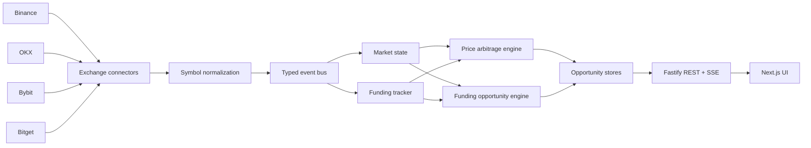

# Crypto Futures Arbitrage Scanner

A real-time market-data system that monitors perpetual futures across multiple centralized exchanges and surfaces cross-exchange price and funding-rate opportunities.

The project focuses on the engineering side of the problem: ingesting heterogeneous WebSocket/REST feeds, normalizing exchange-specific symbols and messages, maintaining a shared market view, ranking opportunities, and streaming updates to a web UI.

> This repository is a scanner and research project. It does not place trades or manage funds.

## What it does

- Streams top-of-book perpetual futures data from **Binance, OKX, Bybit, and Bitget**.
- Discovers and normalizes exchange-specific instrument symbols into a canonical representation.
- Computes cross-exchange price spreads with configurable fee and safety buffers.
- Tracks how long an opportunity remains valid before publishing it.
- Polls funding rates and calculates funding-adjusted opportunities.
- Drops stale market opportunities and publishes a global top-N ranking.
- Exposes REST snapshots and live **Server-Sent Events (SSE)** streams.
- Provides a **Next.js / React** UI with sorting and exchange/symbol filters.

## Architecture



The backend is intentionally split into exchange adapters, domain state, opportunity engines, and delivery layers so exchange-specific protocol details stay outside the core ranking logic.

## Tech stack

**Backend**
- Node.js + TypeScript
- Fastify
- WebSockets (`ws`)
- REST + SSE
- Pino logging
- Zod configuration validation

**Frontend**
- Next.js
- React
- TanStack Table
- TypeScript

## Repository layout

```text
backend/
  src/
    api/          REST and SSE routes
    app/          application composition/startup
    config/       environment and scanner configuration
    core/         symbol normalization, market state, opportunity engines
    exchanges/    exchange-specific discovery, funding, and WebSocket adapters
    streams/      typed event bus and snapshot stores
frontend/
  src/
    app/          scanner pages
    lib/          shared UI utilities such as the SSE hook
shared/
  types.ts        contracts shared by backend and frontend
```

## Opportunity model

For a price opportunity, the scanner considers going **long at the best ask** on one exchange and **short at the best bid** on another.

The gross spread is converted to basis points and reduced by:
- estimated taker fees on both legs;
- a small configurable latency/slippage safety buffer.

An opportunity is published only after it has remained above the configured threshold for a minimum amount of time. The engine also tracks exchange timestamps and removes stale opportunities.

Funding opportunities use the funding-rate difference between the long and short legs while accounting for the immediate entry-price cost.

## Run locally

Requirements:
- Node.js 20+
- npm

### Backend

```bash
cd backend
npm ci
cp .env.example .env
npm run dev
```

The backend defaults to `http://localhost:3001`.

Useful commands:

```bash
npm test
npm run typecheck:backend
npm run lint
npm run build
```

### Frontend

In a second terminal:

```bash
cd frontend
npm ci
cp .env.example .env.local
npm run dev
```

Then open the Next.js app shown in the terminal. The main scanner pages are:

- `/perps-opps` — price-spread opportunities
- `/funding-opps` — funding-rate opportunities

## API

REST snapshots:

```text
GET /health
GET /api/opps
GET /api/funding-opps
```

Live SSE streams:

```text
GET /stream/opps
GET /stream/funding-opps
```

SSE connections receive an initial snapshot, incremental opportunity updates, and periodic heartbeat events.

## Tests and CI

The backend contains focused tests for the exchange-symbol normalization rules, fee calculations, and core arbitrage-engine behavior. GitHub Actions runs backend tests/typechecking and frontend typechecking/linting on pushes and pull requests.

## Design choices

**Canonical symbols.** Each exchange represents perpetual contracts differently. Exchange adapters normalize them before data reaches the domain layer, which keeps the opportunity engines exchange-agnostic.

**Typed event bus.** Market-data producers and consumers communicate through typed events instead of direct dependencies, making connectors and engines easier to evolve independently.

**Throttled publishing.** Market updates can arrive much faster than a browser needs to redraw. Engines update their internal state on every relevant event but publish ranked snapshots on a controlled interval.

**Staleness and time-alive filters.** A large instantaneous spread is not necessarily actionable. Opportunities must persist for a configured duration and are evicted when their underlying market data becomes stale.

## Current limitations

This is an evolving research project rather than an execution system. Current limitations include:
- top-of-book liquidity rather than full depth/slippage modeling;
- static fee assumptions rather than account/VIP-specific fees;
- no order placement, position management, or capital/risk engine;
- no persistent historical market-data store.

Those constraints are deliberate: the current scope is real-time data ingestion, normalization, ranking, and visualization.
